# OntoProduct

온톨로지 기반 제조 제품 등록 교육 프로젝트입니다. 사양서에서 제품 정보를 추출하고, 제품 분류에 정의된 필수 속성·단위·범위·관계에 맞춰 검토한 뒤 SQLite에 저장합니다. 웹 화면에서는 사람이 추출 근거를 확인하고 수정·승인합니다.

**현재 구현 기준: 2026-10-14.** 인증 없이 사용하는 로컬 앱이며, 기본 제품군은 모터·BLDC 모터·베어링입니다. Streamlit 화면, LangGraph 처리 흐름, OpenAI 추출·분류, Python 규칙 및 RDF/SHACL 검증으로 구성돼 있습니다.

## 구현된 화면과 기능

| 화면 | 현재 가능한 작업 |
| --- | --- |
| 제품 등록 | PDF·XLSX·TXT 업로드, 단계별 실행 상태 확인, 추출 값·단위·원문 근거 검토, 제품명·분류·속성 수정, 재검증, 승인·거절, JSON 다운로드 |
| 대시보드 | 등록 제품·전체 작업·검토 대기 건수, 제품 분류·작업 상태 집계, 최근 작업의 미해결 오류와 재추출·재분류 횟수 확인, 작업 다시 열기 |
| 제품 데이터베이스 | 등록 제품 이름 검색·분류 필터, 속성·출처·AI 신뢰도·파일·페이지·근거 확인, 제품 JSON 다운로드 |
| 온톨로지 탐색 | 분류 상속·필수/선택 속성·단위·범위 확인, 단위 변환 미리보기, 온톨로지 관계 및 등록 제품 RDF 그래프, 사양 제약 검사, RDF·그래프 JSON 다운로드 |
| Agent 모니터 | 7개 Agent의 역할·버전·입출력 계약·실행 수·오류·평균 실행 시간, 작업별 로그와 오류 이벤트, 실제 Workflow Graph 및 Mermaid 다운로드 |
| 평가 | 합성 문서와 정답을 이용한 오프라인 파이프라인 평가, 지표·사례별 출력 확인, JSON·Markdown 보고서 다운로드 |

각 기능의 순서도는 아래 설명에 함께 배치했습니다. **온톨로지 구조 그래프**는 분류·속성·관계를, **처리 순서도**는 입력·판단·결과를 보여줍니다. GitHub 등 Mermaid를 지원하는 Markdown 뷰어에서 그래프로 표시됩니다.

Mock 실행 모드, 예제 제품 추가 버튼·서비스·스크립트, 샘플 RDF 선택 UI는 제거했습니다. 제품 화면·집계·중복 조회는 `origin="REGISTRATION"`인 등록 제품을 사용합니다. 과거 `SEED` 행은 삭제하지 않지만 일반 조회에서는 제외합니다. 테스트·평가용 합성 자료는 유지합니다.

## Quick start

Python **3.12**, `uv`, `OPENAI_API_KEY` 환경 변수가 필요합니다. 기본 설정은 저장소의 [llm.yaml](src/ontoproduct/config/llm.yaml)에 있는 `openai / gpt-5`입니다. 키는 설정 파일에 넣지 않으며 `.env`는 자동으로 읽지 않습니다.

Windows PowerShell에서 저장소 루트를 열고 실행합니다. API Key가 없다면 [등록 안내](docs/QUICK_START.md#2-api-key-등록)를 먼저 따르세요. cmd나 Linux·macOS의 명령 문법은 [터미널별 안내](docs/QUICK_START.md#터미널별-명령)를 참고하세요.

```powershell
cd D:\ontology-product-system
uv --cache-dir .uv-cache sync --locked
.venv\Scripts\python.exe -m streamlit run app.py --server.address 127.0.0.1 --server.port 8502
```

[앱 열기](http://127.0.0.1:8502) 후 다음 순서로 사용합니다.

1. 제품 등록 화면에서 제품 하나의 문서를 업로드합니다. 확인용 문서는 [M001 모터 사양서](inputdata/01_normal_motors/M001_bldcmotor.txt)를 사용할 수 있습니다.
2. **업로드 문서로 시작**을 누릅니다.
3. 추출된 값과 원문 근거, 검증 오류, 중복 후보를 확인합니다.
4. 필요한 값을 수정하거나 AI 값을 확인하고 **수정 후 재검증**을 누릅니다.
5. 승인 가능한 상태가 되면 **등록 승인**을 누릅니다.
6. JSON을 다운로드하거나 제품 데이터베이스·온톨로지 탐색에서 등록 결과를 확인합니다.

각 단계의 실제 화면과 나머지 화면까지 이어지는 시연 순서는 [시연 가이드](docs/DEMO.md)에 캡처와 함께 정리돼 있습니다.

문서에서 읽은 원문은 추출·분류를 위해 OpenAI API로 전송되며 호출 비용이 발생합니다. API Key나 설정이 잘못되면 앱은 실행 설정 오류를 표시합니다.

## 제품 등록 처리 흐름

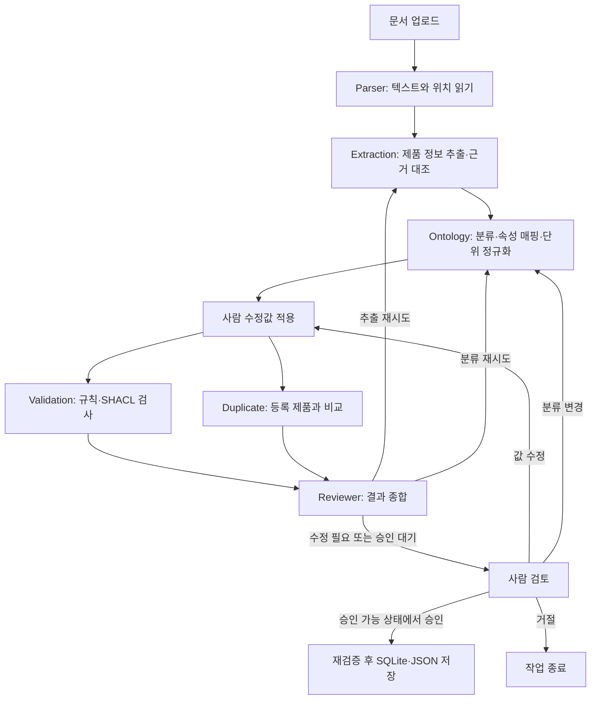

Validation과 Duplicate는 병렬로 실행한 뒤 합류합니다. 재시도 횟수가 소진되면 사람 수정 단계로 이동하며, 단계 실행 오류는 별도의 오류 처리·재시도 경로로 전달합니다. 실제 컴파일된 흐름은 **Agent 모니터 → Workflow Graph**에서 확인할 수 있습니다.

### 문서 읽기와 정보 추출

| 항목 | 구현 내용 |
| --- | --- |
| 파일 입력 | 파일당 최대 20 MB. 한 작업의 여러 파일은 제품 하나의 자료로 처리 |
| TXT | UTF-8, UTF-8 BOM, CP949 읽기 |
| PDF | 텍스트·표 추출, 원본 페이지 번호 보존 |
| XLSX | 시트·행·셀 위치를 텍스트 근거에 포함 |
| 정보 추출 | OpenAI 구조화 응답에서 제품명·분류 후보·속성·값·단위·신뢰도 추출 |
| 근거 검증 | 인용이 해당 파일·페이지의 파싱 원문에 존재하는지, 값·단위가 인용에 포함되는지 대조 |
| 다중 문서 | 속성 별칭과 단위를 통일해 같은 값을 병합하고, 다른 값은 충돌 근거로 보존 |

원문에 없는 값을 정상 추출 결과로 받아들이지 않도록 검증합니다. 다만 이 대조가 문서 자체의 사실성이나 제품의 실제 성능을 보장하지는 않습니다.

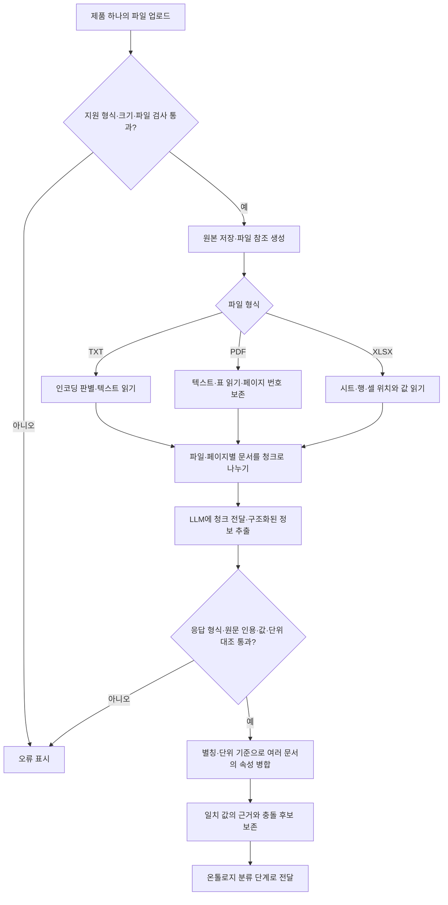

파일 파싱이나 모델 호출 자체의 실패도 오류 처리 경로로 전달됩니다. PDF의 스캔 페이지 처리 제한은 아래 **현재 제한과 보류 항목**을 참고하세요.

### 온톨로지로 검토하는 방식

온톨로지는 제품 분류와 속성의 의미·제약을 정의합니다. 예를 들어 베어링에는 내경·외경을, 모터에는 제조사를, BLDC 모터에는 정격 전압·출력·속도를 정의하며 수치 속성의 표준 단위도 정합니다. 하위 분류는 상위 분류의 속성도 물려받습니다.

**분류별 규칙과 상속 구조**

아래는 현재 정의된 분류와 주요 등록 규칙입니다. 실선은 상위→하위 분류, 점선은 해당 분류에 적용되는 규칙을 뜻합니다. BLDC 모터는 Motor의 제조사 필수 조건도 상속합니다.

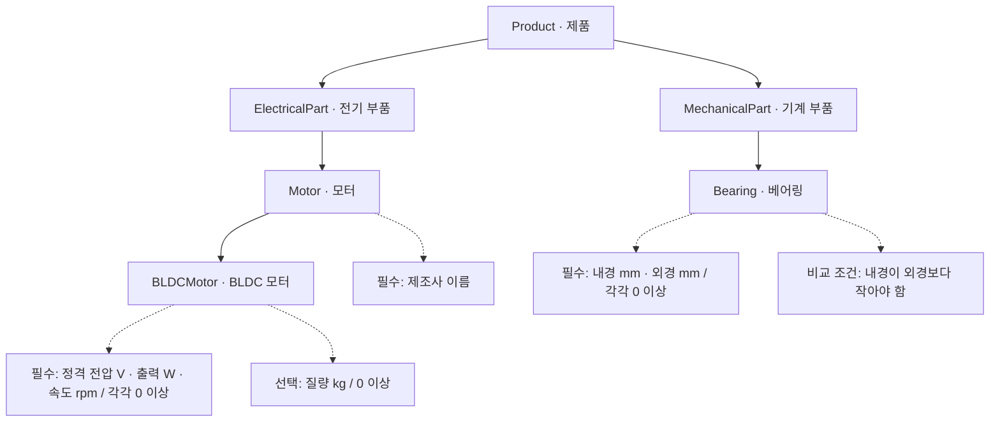

**제품 RDF의 관계 구조**

제품의 속성은 RDF에서 제조사 노드나 물리량 값 노드로 연결됩니다. 아래는 정격 출력의 연결을 설명한 그래프이며 `600 W`는 설명용 수치입니다. 실제 화면은 선택한 등록 제품의 값으로 생성합니다.

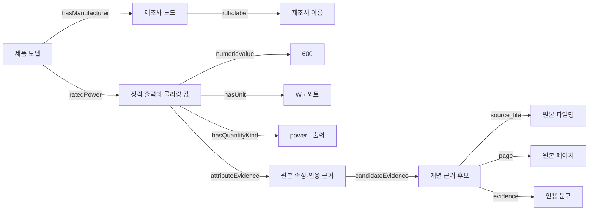

파일·페이지·인용 연결은 해당 근거가 있을 때 표시합니다. 같은 제조사 이름도 제품마다 별도의 노드로 표현하며, 이름만으로 동일한 회사라고 통합하지 않습니다.

**자동 검토 순서**

1. **분류 선택:** AI가 허용된 제품 분류 중 하나를 선택합니다. 추출 속성으로 판단한 규칙 기반 분류와 AI 분류가 다르면 불일치 종류와 근거를 남기고 사람에게 확인을 요청합니다.
2. **속성·단위 정규화:** 분류의 필수·선택 속성을 가져오고, `0.6 kW → 600 W`, `750 g → 0.75 kg`처럼 표준 단위로 변환합니다.
3. **Python 규칙 검사:** 필수값 누락, 자료형, 표준 단위, 최솟값·최댓값을 확인합니다. 선택 속성 누락이나 분류 밖 속성은 경고로 구분합니다.
4. **RDF/SHACL 검사:** 제품을 관계 데이터인 RDF로 변환하고, SHACL 제약으로 속성·단위·물리량·치수 관계를 검사합니다. 오류는 제품 필드에 연결해 표시합니다.
5. **검토 판단:** 값 충돌, 분류 불일치, 필수값 누락 외의 검증 오류(자료형·단위·범위·관계 위반), 사람이 입력한 필수값의 누락은 사람 수정으로 보냅니다. 그 밖의 필수값 누락이나 낮은 AI 신뢰도는 재추출, 낮은 분류 신뢰도는 재분류 대상으로 판단합니다. 기준 신뢰도는 현재 `0.70`이며, 신뢰도가 없는 필수 AI 속성도 재검토합니다.
6. **승인 직전 재검증:** 화면에서 승인했더라도 현재 온톨로지의 규칙과 SHACL을 다시 통과해야 저장합니다.

예를 들어 내경 **30 mm**, 외경 **20 mm**인 제품은 `내경 < 외경` 조건을 위반하므로 등록할 수 없습니다. AI가 베어링을 상위 분류인 `MechanicalPart`로 잘못 선택해도, 두 치수를 해석·비교할 수 있으면 이 관계 위반을 차단합니다.

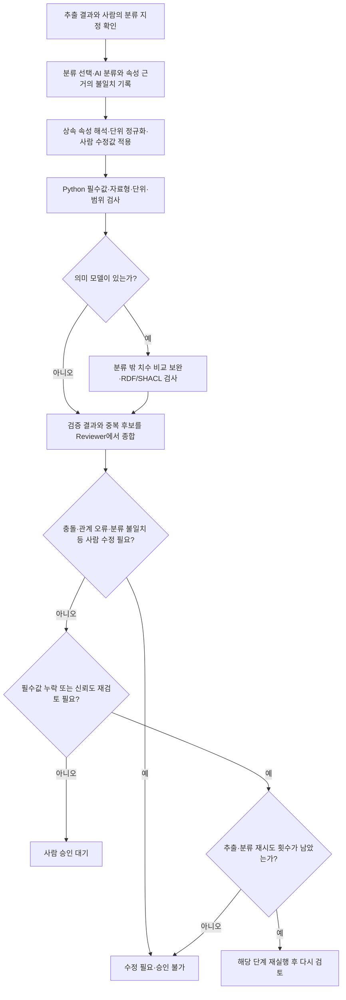

#### 온톨로지 탐색 화면에서 확인하기

웹 화면에서 직접 검사하려면 **온톨로지 탐색 → 제품 데이터 그래프 → 저장 제품 선택 → 사양 제약 검사**를 사용합니다. 제품·제조사·값·단위 관계와 원문 근거를 보고, triple 표·Turtle RDF·그래프 JSON을 확인하거나 다운로드할 수 있습니다. 이 화면의 검사는 읽기 전용이며 제품을 수정하거나 다시 등록하지 않습니다. 등록 제품이 없으면 등록 안내를 표시합니다.

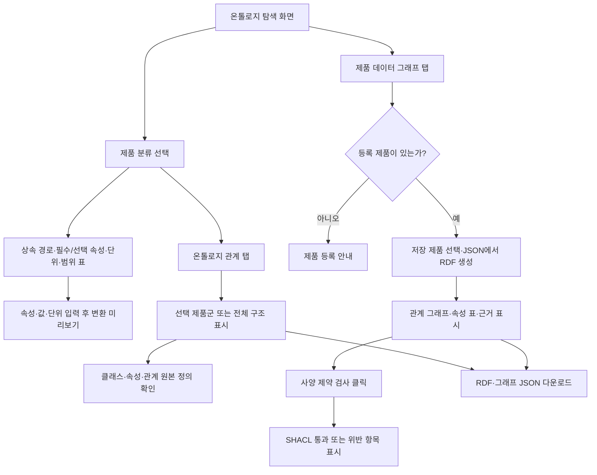

정의와 구현은 [업무 온톨로지](src/ontoproduct/ontology/ontology.yaml), [의미 모델](src/ontoproduct/ontology/product_model.yaml), [등록 검증](src/ontoproduct/services/validation_service.py), [상세 매뉴얼](docs/team/03_PRODUCT_ONTOLOGY.md)에 있습니다. 의미 모델이 없는 사용자 정의 온톨로지는 Python 규칙 검증만 적용합니다.

### 중복 조회

같은 분류의 등록 제품 전체를 SQLite에서 읽어 제품명과 핵심 사양을 비교합니다. 단위를 정규화한 뒤 일치·근사·충돌·누락을 구분하고, 기본 상위 3개 후보와 점수·판정·비교 근거를 반환합니다. 같은 점수는 `product_id` 순서로 정렬하며 후보가 실제 DB에 존재하는지도 검증합니다.

제품명이 같지만 사양이 충돌하는 경우도 검토 후보가 될 수 있습니다. 중복 후보는 사람이 판단할 정보이며 자동 병합·삭제하거나 후보 존재만으로 등록을 차단하지 않습니다. 임베딩·벡터 DB 검색은 구현하지 않았습니다.

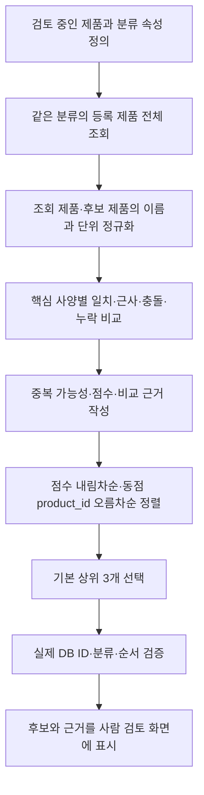

### 사람 검토와 저장

- 제품명·분류·속성 값을 수정하거나 AI 값을 확인한 뒤 재검증할 수 있습니다.
- 사람 수정값은 `HUMAN` 출처와 잠금 상태로 보존해 재추출 결과가 덮어쓰지 않도록 합니다. 분류 변경으로 적용할 수 없어진 수정값도 별도로 보관합니다.
- UI의 승인은 검토 결과가 `READY_FOR_HUMAN`일 때만 가능합니다. 오류가 남으면 승인할 수 없으며 거절할 수도 있습니다.
- 저장은 작업 ID 기준으로 중복 실행을 방지합니다. 같은 작업을 반복 승인해도 같은 제품을 반환합니다.
- 등록 제품은 SQLite의 `product_json`에 저장하고 JSON 파일로 내보냅니다. DB 저장 후 JSON 내보내기가 실패하면 재시도 시 기존 제품을 사용합니다.

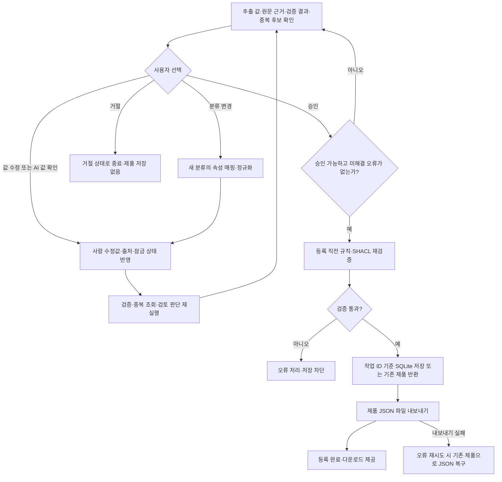

## 대시보드와 제품 데이터베이스

### 대시보드 집계와 작업 다시 열기

제품·작업 건수는 SQLite 집계이며, 오류·재시도 통계는 최근 최대 100개 작업의 체크포인트를 읽어 계산합니다.

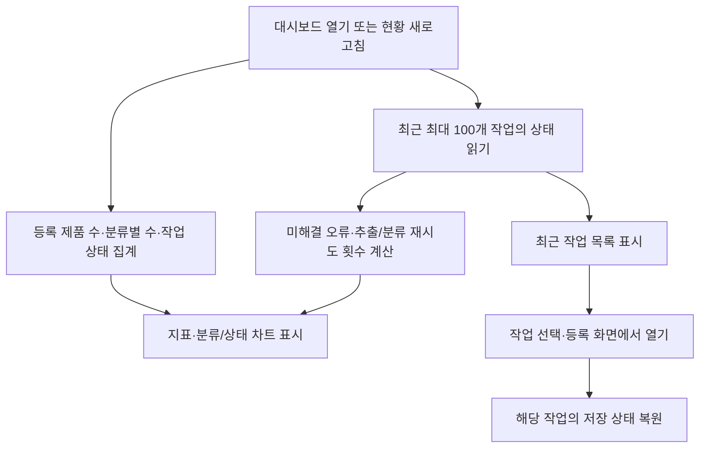

### 제품 검색·상세 조회·JSON 다운로드

제품 데이터베이스는 검색 조건에 맞는 최신 최대 500개 등록 제품을 표시합니다. 상세 조회와 다운로드는 저장된 제품을 읽으며 수정·삭제하지 않습니다.

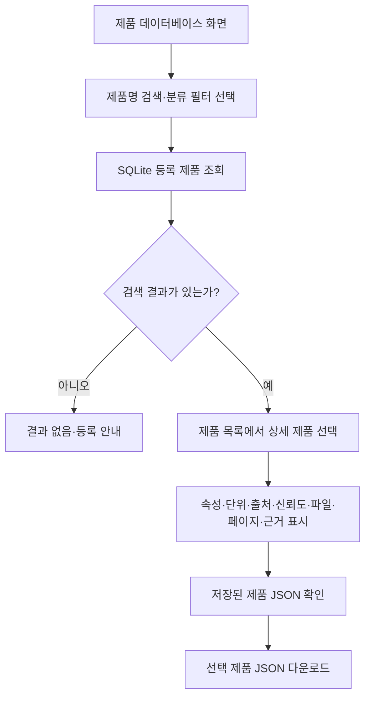

## 작업 복원·오류 대응·모니터링

### 작업 상태 복원

작업 상태와 LangGraph 체크포인트는 SQLite에 남습니다. 사이드바의 **최근 작업**, 대시보드의 **등록 화면에서 열기**, `?case=<작업 ID>` 링크로 작업을 다시 열 수 있습니다. 중단된 실행은 이어가고, 검토 대기 작업은 수정·승인·거절할 수 있습니다.

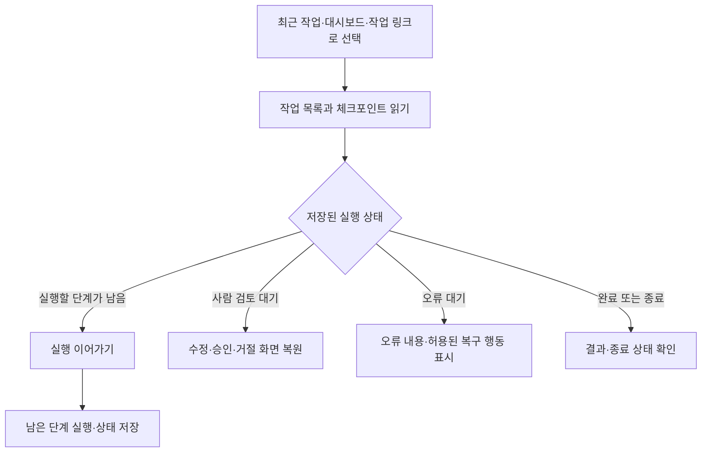

### 자동 재시도와 실행 오류 대응

등록 화면에서 추출·분류의 추가 시도를 각각 0~3회로 설정할 수 있으며 기본값은 각각 1회입니다. 복구 가능한 실행 오류는 **오류 재시도**, 계속 진행할 수 없는 작업은 **작업 중단**으로 처리합니다. 오류 이력은 해결 여부와 함께 보존합니다.

업무상 재추출·재분류는 위 자동 검토 순서도를 따릅니다. 아래는 파일 읽기·모델 호출·저장 등 단계 실행 중 예외가 발생했을 때의 경로입니다.

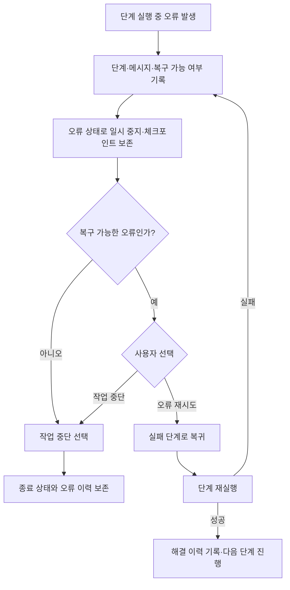

Validation 또는 Duplicate 오류의 재시도는 사람 수정값 적용 단계로 돌아가 두 검사를 다시 수행합니다.

### Agent 모니터

Agent 모니터에는 Parser·Extraction·Ontology·Validation·Duplicate·Reviewer·Registration의 실행 로그와 계약이 표시됩니다. 평균 시간은 기록된 실행 시간으로 계산합니다. `Health`는 Agent의 자체 응답이며 외부 모델 API 연결 검사가 아닙니다.

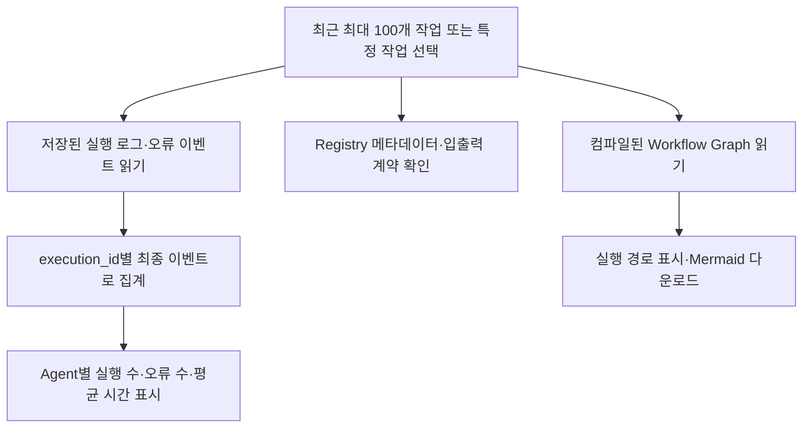

## 평가와 테스트

### 문서 파이프라인 평가

평가 화면은 [inputdata](inputdata/README.md)의 합성 문서와 정답을 사용합니다. 실제 Parser와 업무 Agent를 실행하되 LLM 자리에 정답 기반 참조 응답을 넣으므로, **오프라인 평가 지표는 실제 LLM 추출 품질이 아니라 파이프라인 동작을 측정합니다.** 평가 실행은 격리된 임시 DB를 사용합니다.

보고서에는 기대 결과 일치율, 속성 탐지 Precision/Recall/F1, 값·단위 정확도, 분류 정확도, 필수 필드 탐지 정확도, 사례별 출력·실패·분모와 원본/정답 hash가 포함됩니다. 실제 모델 평가는 별도 CLI의 `--live` 옵션으로 실행하며 호출 수·시간 제한이 필요합니다. 명령과 지표 정의는 [평가 안내](eval/README.md)를 참고하세요.

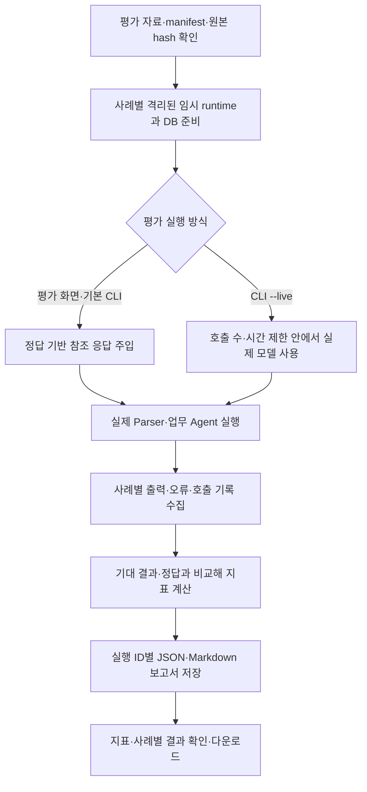

### 자동 회귀 테스트

자동 회귀 테스트는 저장소 루트의 PowerShell에서 실행합니다.

```powershell
$env:UV_CACHE_DIR = "$PWD\.uv-cache"
$env:ONTOPRODUCT_LIVE_LLM = "0"
uv run pytest -q
```

기본 테스트는 실제 모델을 호출하지 않습니다. 서비스·워크플로·DB 저장·체크포인트 복원·Streamlit AppTest 화면 검증을 포함합니다. 시스템 Python의 `pytest` 대신 프로젝트 의존성이 적용되는 `uv run pytest -q`를 사용합니다.

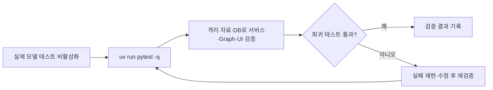

## CLI

UI와 같은 처리 흐름을 터미널에서도 실행할 수 있습니다. 사람 검토 명령을 직접 입력하려면 `--interactive`를 사용합니다.

```powershell
.venv\Scripts\python.exe -m ontoproduct.cli --interactive inputdata\01_normal_motors\M001_bldcmotor.txt
```

검토 대기 시 `{"action":"APPROVE"}` 같은 JSON 명령을 입력합니다. **`--interactive`를 생략하면 등록 가능한 제품은 CLI가 자동 승인합니다.** 수정이 필요하면 작업을 대기 상태로 남기며, 오류 대기는 중단합니다. UI에서 이어서 처리할 때는 출력된 `Case` ID를 사용합니다.

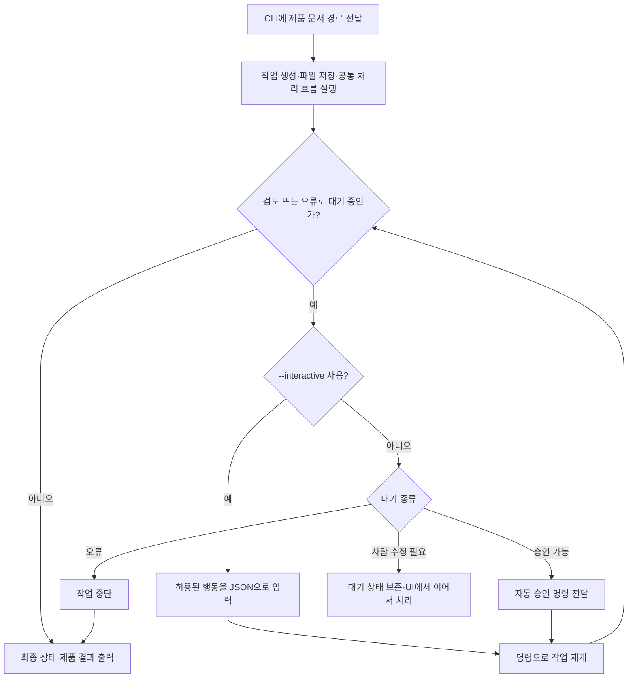

## 데이터 저장과 설정

| 위치·설정 | 용도 |
| --- | --- |
| `runtime/uploads/` | 업로드 원본 |
| `runtime/data/ontoproduct.db` | 등록 제품과 작업 목록 |
| `runtime/data/checkpoints.db` | 처리 상태·검토 대기·복원용 체크포인트 |
| `runtime/exports/` | 등록 제품 JSON |
| `runtime/evaluation/<run_id>/` | 화면에서 실행한 평가 보고서 |
| `ONTOPRODUCT_DATA_DIR` | 기본 `runtime/` 대신 사용할 데이터 루트 |
| `OPENAI_API_KEY` | 환경 변수에서 읽는 API Key |
| [llm.yaml](src/ontoproduct/config/llm.yaml) | 모델·요청 timeout·전송 재시도 설정. 환경 변수가 우선 |

제품의 기준 데이터는 SQLite JSON입니다. RDF는 필요할 때 생성하며 별도 RDF DB에 지속 저장하지 않습니다. `runtime/`은 Git 추적에서 제외됩니다. 데이터 폴더 변경·백업 방법은 [사용자 매뉴얼](docs/USER_MANUAL.md)을 참고하세요.

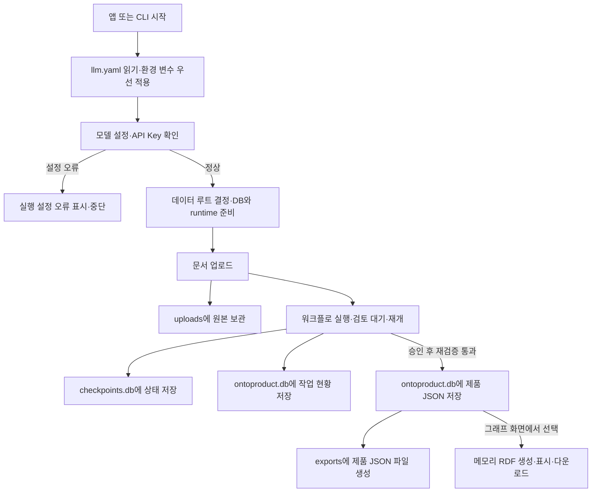

## 코드 구조

| 위치 | 역할 |
| --- | --- |
| [views](src/ontoproduct/views/) | Streamlit 화면 |
| [agents](src/ontoproduct/agents/) | 단계별 입출력 계약과 실행 |
| [graph](src/ontoproduct/graph/) | 실행 순서·병렬 합류·재시도·사람 검토 |
| [services](src/ontoproduct/services/) | 파싱·LLM·정규화·근거 검사·검증·저장 기능 |
| [schemas](src/ontoproduct/schemas/) | Pydantic 데이터 계약 |
| [repositories](src/ontoproduct/repositories/) | SQLite 조회·저장 |
| [ontology](src/ontoproduct/ontology/) | 분류·속성·단위 매핑·의미 모델·RDF/SHACL |
| [evaluation](src/ontoproduct/evaluation/) · [tests](tests/) | 평가 실행·자동 회귀 검증 |

## 현재 제한과 보류 항목

- **OCR 미지원:** 텍스트를 읽을 수 없는 전체 스캔 PDF는 오류로 거부합니다. 현재 파서는 텍스트가 없는 페이지를 건너뛰므로, 텍스트/스캔 혼합 PDF는 스캔 페이지가 누락될 수 있습니다.
- **로컬 교육용:** 사용자 인증·권한 관리와 운영용 서비스 구성은 구현하지 않았습니다.
- **한 작업에 제품 하나:** 여러 파일을 제품별로 자동 분할해 일괄 등록하지 않습니다.
- **중복 조회 규모:** 같은 분류 전체를 비교합니다. 대규모 검색 최적화와 운영 SLA는 확정하지 않았습니다.
- **RDF 범위:** 제품별 그래프·SHACL·다운로드를 지원합니다. 여러 제품을 묶는 SPARQL 화면·endpoint와 지속 RDF 저장소는 없습니다.
- **저장 후 변경:** 등록 전 수정은 지원하지만 저장된 제품의 수정·삭제 UI는 없습니다.
- **검증의 범위:** 정의된 규칙 및 원문 근거와의 일치를 검사합니다. 실제 제품 성능이나 문서의 사실성을 인증하지 않습니다.

OCR·중복 조회 확장·RDF 저장 확장은 실제 요구가 확인될 때 착수합니다. 결정과 기준은 [6~8 요구 확인 기록](docs/team/04_REQUIREMENTS_06_08.md)에 있습니다.

## 상세 매뉴얼

| 목적 | 문서 |
| --- | --- |
| 설치, pip 대안, API Key 등록, 첫 등록 | [Quick start](docs/QUICK_START.md) |
| 화면별 사용법, 등록·수정·승인, 작업 복원, 오류 대응 | [사용자 매뉴얼](docs/USER_MANUAL.md) |
| 온톨로지 정의·RDF·SHACL | [제품 온톨로지 매뉴얼](docs/team/03_PRODUCT_ONTOLOGY.md) |
| 코드 구조, 테스트, CLI, 평가, 패키징 | [개발자 매뉴얼](docs/DEVELOPER_GUIDE.md) |
| 전체 가이드·이력 찾아보기 | [문서 목차](docs/README.md) |

단계별 완료 보고서는 당시 상태를 기록한 이력입니다. 현재 기능과 실행 방법은 이 README 및 연결된 매뉴얼을 기준으로 확인하세요.
