# 시연 가이드

[문서 목차](README.md) · [프로젝트 홈](../README.md)

M001 모터 사양서 한 건을 업로드해 등록하고, 그 결과를 나머지 다섯 화면에서 확인하는 순서입니다. 전체 시연은 10분 정도 걸립니다.

이 문서의 화면은 2026-10-14에 빈 데이터 폴더와 `openai / gpt-5` 설정으로 실제 실행해 캡처했습니다. 작업 ID, 시각, 실행 시간은 실행할 때마다 달라집니다.

## 시연 전 준비

1. `OPENAI_API_KEY` 환경 변수가 등록되어 있는지 확인합니다. 없으면 [API Key 등록](QUICK_START.md#2-api-key-등록)을 따릅니다.
2. 기존 제품·작업과 섞이지 않도록 시연용 빈 데이터 폴더를 지정하고 앱을 실행합니다.

   ```powershell
   cd D:\ontology-product-system
   $env:ONTOPRODUCT_DATA_DIR = "D:\ontology-product-system\runtime\demo"
   .venv\Scripts\python.exe -m streamlit run app.py --server.address 127.0.0.1 --server.port 8502
   ```

3. 업로드할 파일로 [M001 모터 사양서](../inputdata/01_normal_motors/M001_bldcmotor.txt)를 준비합니다.

업로드한 원문은 OpenAI API로 전송되며 호출 비용이 발생합니다. 캡처할 때는 업로드부터 승인 대기까지 약 36초가 걸렸습니다(추출 21초, 분류 9초). 처음 상태로 다시 시연하려면 서버를 끄고 `runtime\demo`를 지우거나 새 폴더 이름을 사용합니다. 자세한 방법은 [새 DB로 테스트와 초기화](USER_MANUAL.md#새-db로-테스트와-초기화)를 참고하세요.

## 시연 순서

| 순서 | 화면 | 보여줄 내용 |
| --- | --- | --- |
| 1 | 제품 등록 | 업로드 → 단계별 실행 → 사람 검토 → 승인·저장 |
| 2 | 대시보드 | 등록 결과가 집계와 최근 작업에 반영됨 |
| 3 | 제품 데이터베이스 | 저장된 값과 원문 근거 |
| 4 | 온톨로지 탐색 | 분류 상속·속성 규칙, 등록 제품의 RDF 그래프 |
| 5 | Agent 모니터 | Agent별 실행 기록과 실제 처리 흐름 그래프 |
| 6 | 평가 | 합성 문서 75개 사례의 오프라인 파이프라인 평가 |

## 1. 제품 등록

### 1-1. 문서 업로드

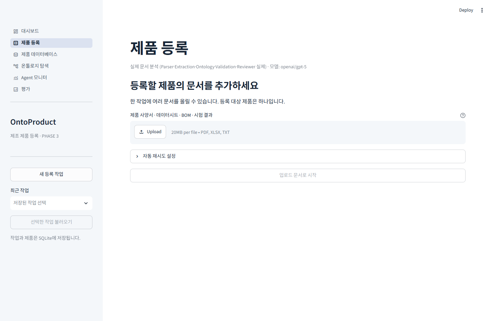

앱을 열면 제품 등록 화면이 기본으로 나옵니다. 제목 아래에 실제 문서 분석 모드와 사용 모델(`openai/gpt-5`)이 표시됩니다.

- PDF·XLSX·TXT를 올릴 수 있습니다. 한 작업에 올린 여러 파일은 제품 하나의 자료로 처리합니다.
- **자동 재시도 설정**에서 정보 추출·분류 매핑의 추가 시도 횟수를 0~3회로 정합니다. 기본값은 각 1회입니다.

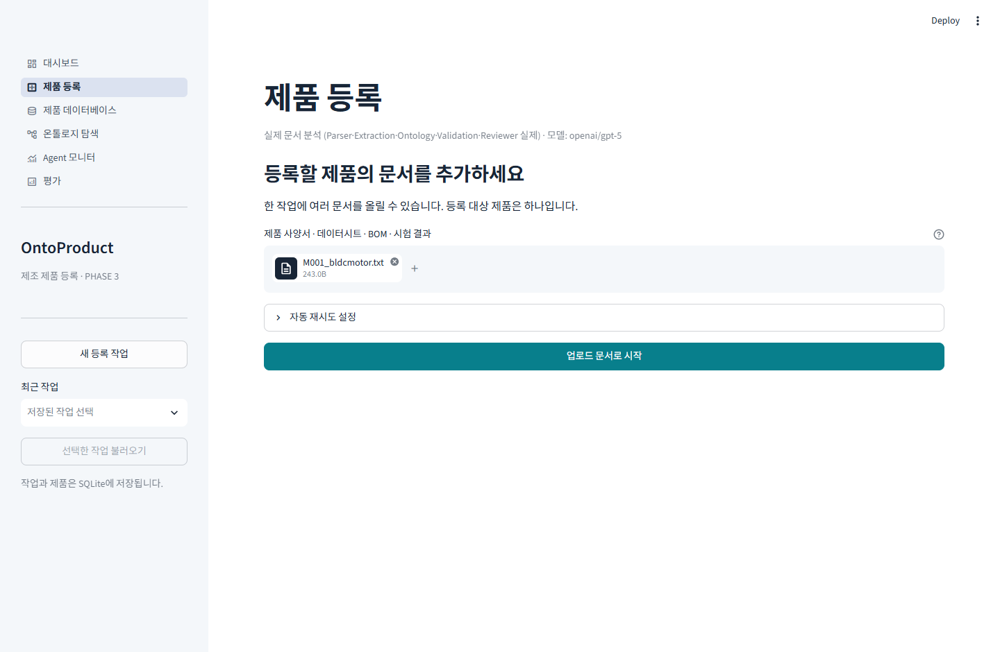

M001 파일을 올리면 **업로드 문서로 시작** 버튼이 활성화됩니다.

### 1-2. 단계별 실행

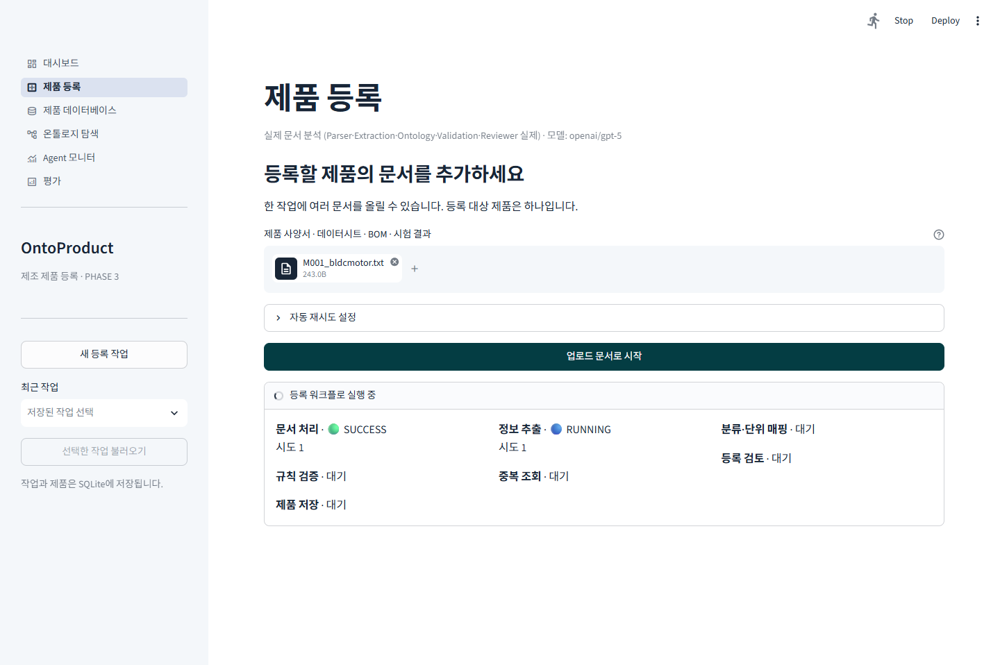

시작을 누르면 단계별 진행 상태가 표시됩니다. 캡처 시점에는 문서 처리가 끝났고 정보 추출(LLM 호출)이 진행 중입니다.

- 문서 처리 → 정보 추출 → 분류·단위 매핑 → 규칙 검증·중복 조회(병렬) → 등록 검토 순서로 진행하며, 각 단계는 Agent 하나가 맡습니다. 제품 저장은 사람이 승인한 뒤에 실행됩니다.
- 정보 추출은 추출한 값마다 원문 인용이 실제 문서에 있는지, 값과 단위가 인용에 들어 있는지 대조합니다.

### 1-3. 사람 검토

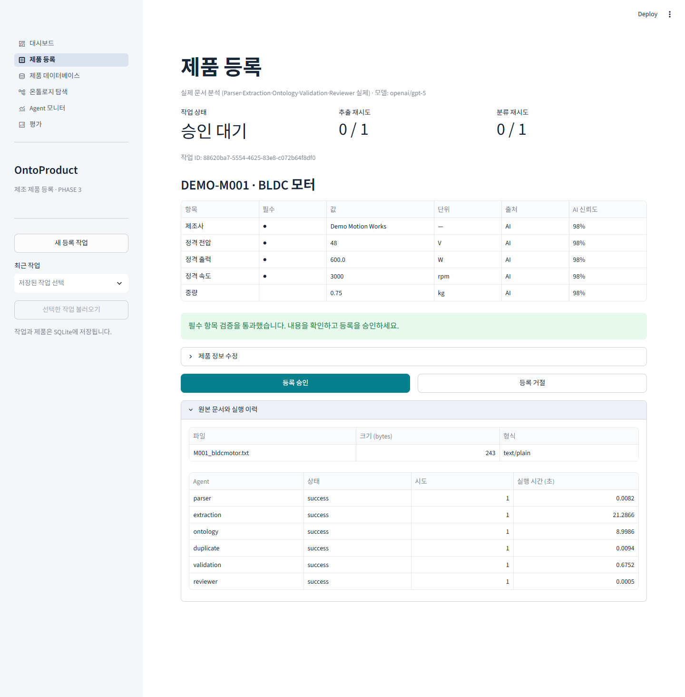

자동 검토가 끝나면 처리 흐름이 사람 검토에서 멈추고 결과를 보여줍니다.

- **상단 지표:** 작업 상태는 **승인 대기**이고, 추출·분류 재시도는 사용하지 않았습니다(0 / 1).
- **속성 표:** 원문 `Rated Power: 0.6 kW`는 표준 단위 `600.0 W`로, `Weight: 750 g`는 `0.75 kg`로 정규화됐습니다. `●`는 BLDC 모터 분류의 필수 속성입니다.
- **검증 결과:** 필수 항목 검증을 통과해 **등록 승인** 버튼이 활성화됐습니다.
- **원본 문서와 실행 이력:** 업로드 파일과 Agent별 상태·실행 시간을 확인합니다.
- **중복 후보:** 첫 제품이라 표시되지 않았습니다. 비슷한 제품이 이미 등록돼 있으면 이 화면에 후보와 규칙 기반 유사도가 나타납니다.
- **값 수정:** 값이 틀렸으면 **제품 정보 수정**에서 고친 뒤 **수정 후 재검증**을 누릅니다. 사람이 수정한 값은 이후 재추출 결과가 덮어쓰지 않습니다.

### 1-4. 승인과 저장

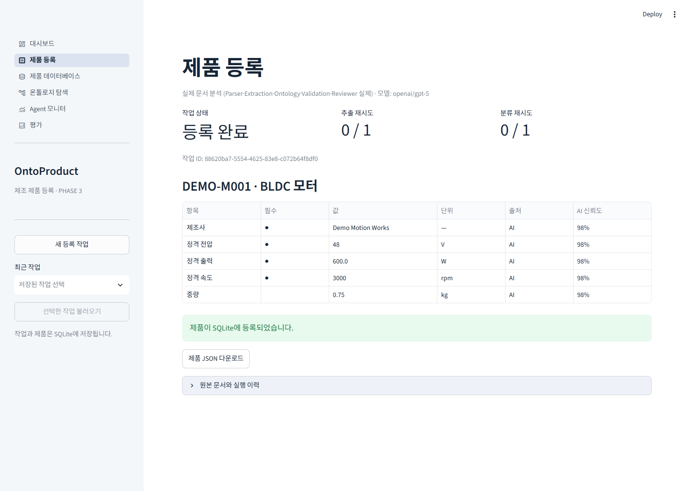

**등록 승인**을 누르면 승인 직전에 규칙·SHACL 검증을 한 번 더 거친 뒤 SQLite에 저장하고 JSON 파일을 내보냅니다. 작업 상태가 **등록 완료**로 바뀌고 **제품 JSON 다운로드** 버튼이 나타납니다.

## 2. 대시보드

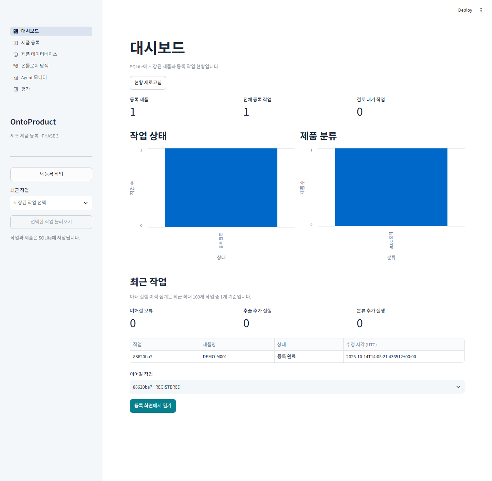

방금 등록한 결과가 집계에 반영된 것을 보여줍니다.

- 등록 제품 1, 전체 등록 작업 1, 검토 대기 작업 0
- 작업 상태별·제품 분류별 차트
- 최근 작업의 미해결 오류, 추출·분류 추가 실행 횟수, 작업 목록
- **등록 화면에서 열기**로 지난 작업을 다시 열 수 있습니다.

## 3. 제품 데이터베이스

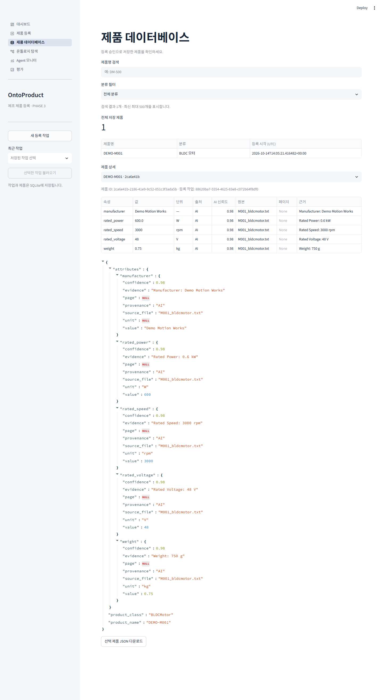

- 제품명 검색과 분류 필터로 등록 제품을 찾습니다.
- **제품 상세**에서 속성별 값·단위·출처·AI 신뢰도·원본 파일·근거 인용을 확인합니다. 출처는 AI가 추출한 값이면 `AI`, 사람이 수정한 값이면 `HUMAN`입니다.
- 아래 JSON은 SQLite에 저장된 제품 데이터 그대로이며 **선택 제품 JSON 다운로드**로 받을 수 있습니다.
- TXT 문서에는 페이지가 없어서 페이지 칸에 `None`이 표시됩니다.

## 4. 온톨로지 탐색

### 4-1. 분류 규칙과 개념 관계

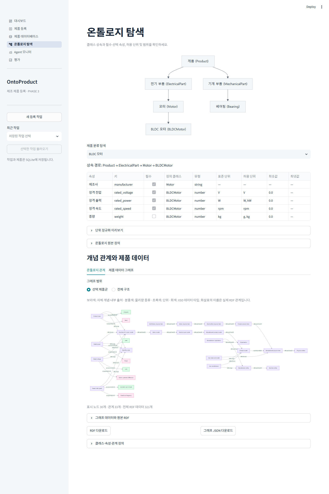

- **분류 트리:** Product → ElectricalPart → Motor → BLDCMotor, MechanicalPart → Bearing 상속 구조입니다.
- **제품 분류 탐색:** BLDC 모터를 고르면 상속 경로와 속성별 필수 여부, 정의 클래스, 표준·허용 단위, 범위가 나옵니다. 제조사는 상위 분류인 Motor에서 물려받은 필수 속성입니다.
- **단위 정규화 미리보기:** 값과 단위를 넣어 표준 단위로 변환되는 결과를 바로 확인할 수 있습니다.
- **온톨로지 관계 탭:** 선택 제품군의 RDF 개념 그래프입니다. 보라색은 자체 개념, 분홍색은 물리량 종류, 초록색은 단위, 회색은 XSD 데이터 타입입니다.

### 4-2. 등록 제품의 RDF 그래프

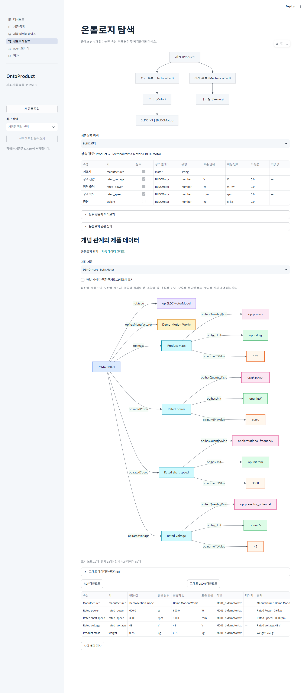

**제품 데이터 그래프** 탭에서 저장 제품 `DEMO-M001`을 선택합니다.

- 제품 노드에서 제조사와 각 속성의 물리량 값 노드로 연결되고, 값 노드는 수치·단위·물리량 종류를 가집니다. 예를 들어 Rated power는 `600.0`, `W`, `power`로 연결됩니다.
- **파일·페이지·원문 근거도 그래프에 표시**를 체크하면 근거 노드까지 그립니다.
- **사양 제약 검사**를 누르면 SHACL로 제품을 검사합니다. 읽기 전용이라 제품을 수정하지 않습니다.
- RDF와 그래프 JSON을 다운로드할 수 있습니다.

## 5. Agent 모니터

### 5-1. Agent 상태

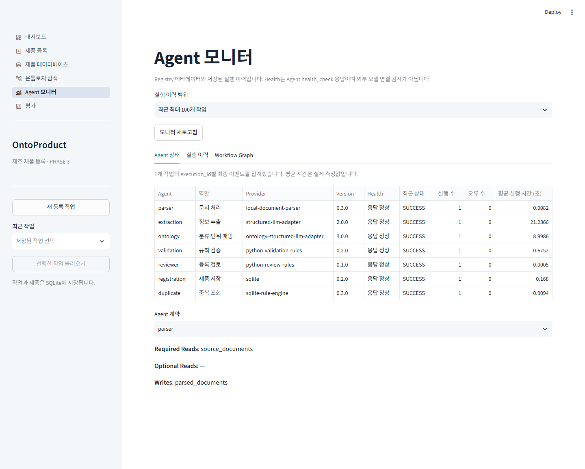

- Agent 7개의 역할, Provider, 버전, Health, 실행 수, 오류 수, 평균 실행 시간을 보여줍니다.
- Health는 Agent 자체 응답이며 OpenAI 연결 검사가 아닙니다.
- **Agent 계약**에서 Agent별로 읽고 쓰는 상태 키를 확인합니다. 예를 들어 parser는 `source_documents`를 읽어 `parsed_documents`를 씁니다.

### 5-2. 실행 이력

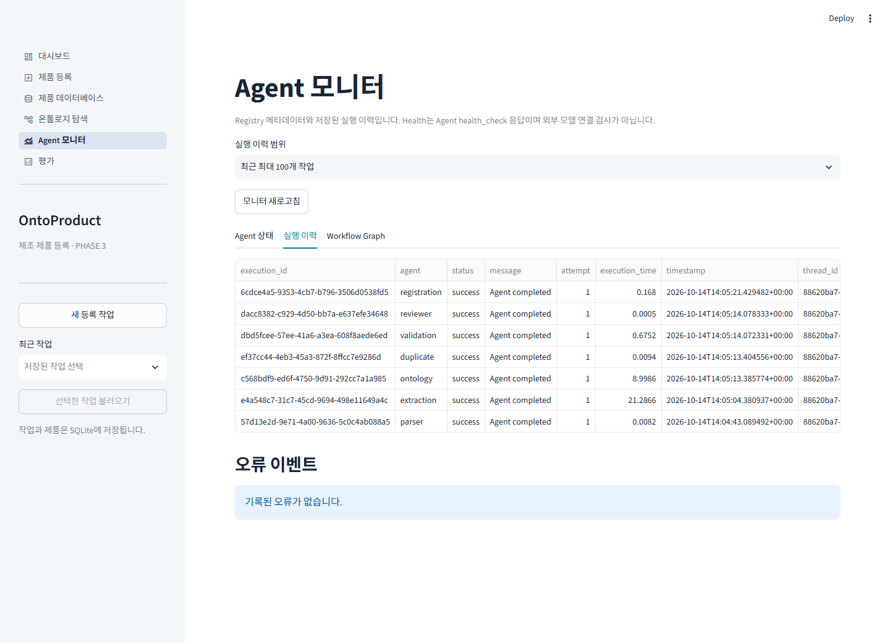

실행 단위(`execution_id`)별로 Agent·상태·시도 횟수·실행 시간·작업 ID가 기록됩니다. 이 실행에서는 오류 이벤트가 없습니다.

### 5-3. Workflow Graph

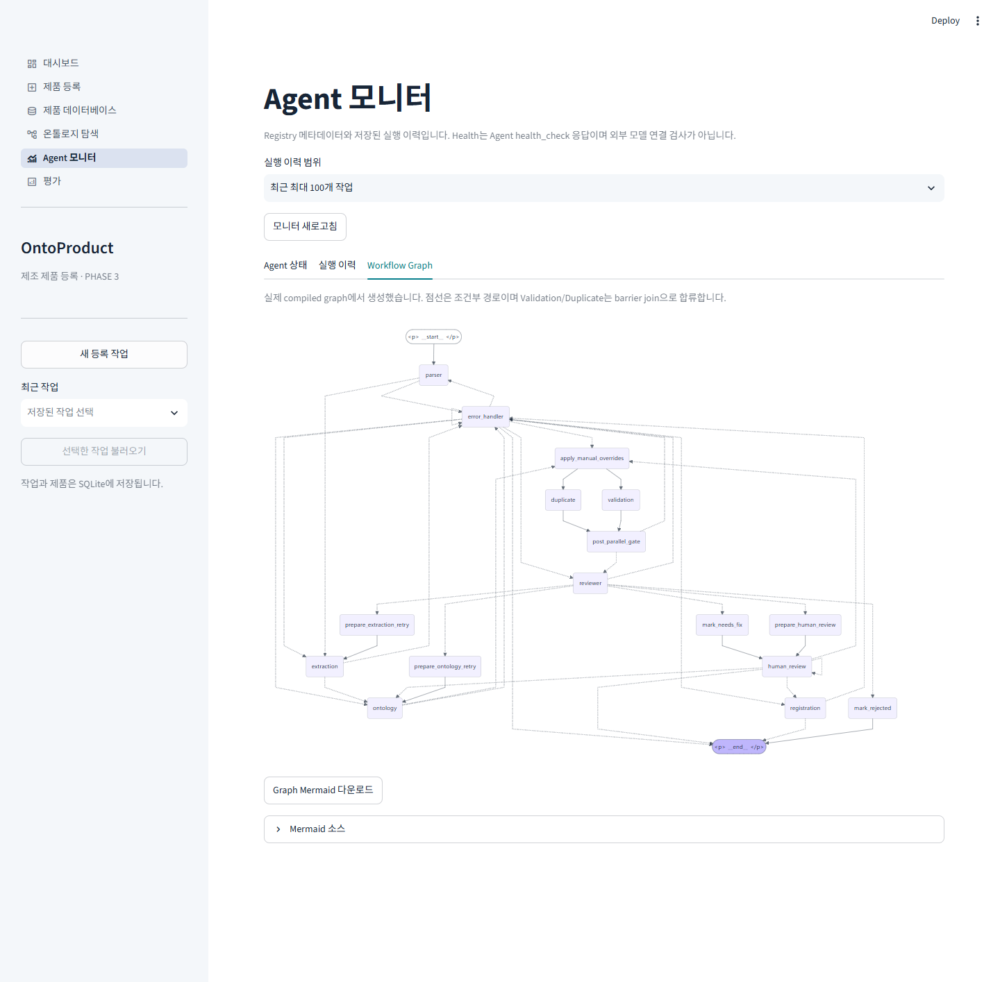

실제 컴파일된 LangGraph에서 생성한 처리 흐름입니다.

- 점선은 조건에 따라 갈라지는 경로입니다. 재시도, 오류 처리, 사람 검토 분기가 여기에 해당합니다.
- validation과 duplicate는 병렬로 실행된 뒤 `post_parallel_gate`에서 합류합니다.
- 시작·끝 노드의 라벨에 `<p>` 태그가 그대로 보이는 표시 문제가 있습니다.

## 6. 평가

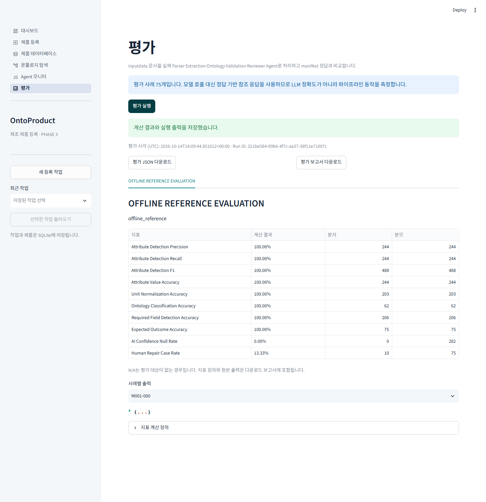

**평가 실행**을 누르면 [inputdata](../inputdata/README.md)의 합성 문서 75개 사례를 실제 Parser와 Agent로 처리합니다. 이때 LLM 대신 정답 기반 참조 응답을 넣으므로 API를 호출하지 않으며 비용이 들지 않습니다.

- 속성 탐지 Precision·Recall·F1과 값·단위·분류·필수 필드·기대 결과 정확도가 모두 100%입니다.
- AI Confidence Null Rate(신뢰도가 없는 AI 속성 비율)는 0%입니다.
- Human Repair Case Rate 13.33%(10 / 75)는 검토 결과가 사람 수정 필요(`NEEDS_FIX`)로 끝난 사례의 비율입니다. 기대 결과 정확도가 100%이므로 이 10건은 예상한 결과입니다.
- **결과 해석:** 100%는 실제 LLM의 추출 정확도가 아닙니다. 정답 응답이 주어졌을 때 파이프라인이 올바르게 처리한다는 뜻입니다. 실제 모델 평가는 CLI의 `--live` 옵션으로 실행합니다([평가 안내](../eval/README.md)).
